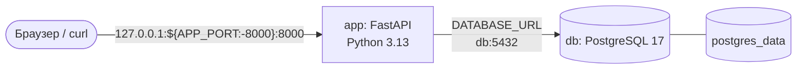

# Схема окружения проекта LifeFlow

**Команда:** LifeFlow

**Проект:** LifeFlow — система управления личными задачами, целями и финансами. Приложение позволяет пользователям планировать личные дела, отслеживать цели и вести учёт доходов и расходов.

**Дата:** 2026-11-19

## 0. Кто что делал

Распределение участников команды и их роли в проекте:

| Участник | Роль в команде | Область ответственности |
|---|---|---|
| Салахетдинов Камиль (@KamilS25) | Team Lead / Product Owner, Tech Lead / Backend Developer | Координация команды, технические решения и серверная разработка |
| Богаенко Елизавета (@ka-chow) | Frontend Developer | Разработка пользовательской части приложения |
| Сулейманова Виктория (@vst-17) | DevOps Engineer | Инфраструктура, окружение и автоматизация сборки и запуска |

В рамках практики №3 подготовлены конфигурация Docker Compose, Dockerfile, пример файла переменных окружения, подключение PostgreSQL и проверка доступности базы данных через health-check.

## 1. Схема

Схема окружения состоит из двух сервисов:

- `app` — FastAPI-приложение LifeFlow.
- `db` — база данных PostgreSQL 17.

Пользователь обращается к приложению через опубликованный порт. Приложение подключается к PostgreSQL по внутреннему адресу `db:5432` в сети Docker Compose. Данные базы сохраняются в именованном томе `postgres_data`.



## 2. Таблица сервисов

| Сервис | Образ или сборка | Порты `хост:контейнер` | Переменные окружения (только имена, без значений) | Тома | Зависит от (условие) | Healthcheck |
|---|---|---|---|---|---|---|
| app | `build: .` | `127.0.0.1:${APP_PORT:-8000}:8000` | `DATABASE_URL`, `PGDATABASE`, `PGUSER`, `PGPASSWORD` | — | `db` (`service_healthy`) | HTTP-запрос к `/health` |
| db | `postgres:17` | Не публикуется. В сети Compose доступен порт 5432 | `POSTGRES_DB`, `POSTGRES_USER`, `POSTGRES_PASSWORD` | `postgres_data:/var/lib/postgresql/data` | — | `pg_isready` по TCP на `127.0.0.1` |

Дополнительные сервисы не используются.

Порт приложения задаётся переменной `APP_PORT`. По умолчанию используется порт 8000. Если он занят на компьютере разработчика, его можно изменить в локальном файле `.env`.

## 3. Ответы на контрольные вопросы

### 1. Адрес базы

Приложение подключается к PostgreSQL по внутреннему адресу Docker Compose:

`postgresql://db:5432`

`DATABASE_URL` определяет адрес сервиса. Драйвер берёт имя базы, пользователя и пароль из `PGDATABASE`, `PGUSER` и `PGPASSWORD`. Compose берёт эти значения из тех же переменных `POSTGRES_*`, которые получает PostgreSQL.

Имя хоста `db` соответствует имени сервиса PostgreSQL в `compose.yaml`. Использование `localhost` внутри контейнера приложения не подходит, поскольку у контейнеров собственные сетевые пространства.

### 2. Судьба данных

Данные PostgreSQL сохраняются в именованном Docker-томе `postgres_data`.

- После `docker compose down` контейнеры останавливаются и удаляются, но именованный том сохраняется. Данные базы остаются.
- После `docker compose down -v` удаляется также именованный том. Данные базы будут потеряны.

### 3. Образ и запуск

При сборке образа приложения в него попадают:

- исходный код приложения;
- `Dockerfile`;
- `pyproject.toml`;
- `uv.lock`;
- установленные зависимости Python;
- исполняемый файл менеджера зависимостей `uv`.

Параметры соединения с PostgreSQL контейнер приложения получает при запуске через переменные окружения из таблицы сервисов.

Файл `.env` используется локально Docker Compose для подстановки переменных и не включается в образ приложения. Секреты не хранятся в исходном коде и не должны попадать в Git. Для передачи конфигурации в репозитории предусмотрен `.env.example` без действующих секретов.

### 4. Миграции

На текущем этапе отдельный механизм миграций базы данных в проекте ещё не реализован.

При первом запуске на пустом томе PostgreSQL создаёт пользователя и пустую базу по переменным `POSTGRES_DB`, `POSTGRES_USER` и `POSTGRES_PASSWORD`. Для проверки `SELECT 1` прикладные таблицы не требуются.

### 5. Запуск и проверка

Для запуска всего стека используется команда:

```powershell
docker compose up --build --wait
```

Для проверки состояния контейнеров:

```powershell
docker compose ps
```

Для проверки работоспособности приложения и подключения к PostgreSQL:

```powershell
Invoke-RestMethod http://localhost:8000/health
```

Ожидаемый ответ:

```json
{
  "status": "healthy",
  "database": "ok"
}
```

Эндпоинт `/health` выполняет запрос `SELECT 1` к PostgreSQL. Если база данных недоступна, приложение возвращает HTTP 503.

## 4. Проверка запуска

- На новом томе `docker compose up --build --wait` переводит оба сервиса в состояние `healthy`. На `localhost:8000/health` получен HTTP 200.
- При остановке базы `/health` возвращает HTTP 503, а `/` — HTTP 200. После запуска базы `/health` снова возвращает HTTP 200.
- Контрольная запись в PostgreSQL сохранилась после `docker compose down` и последующего запуска.

## 5. Уточнения конфигурации

| Наблюдение | Изменение |
|---|---|
| PostgreSQL был опубликован на хосте без потребности для локального стека. | С хоста доступен только порт FastAPI. Приложение использует `db:5432` в сети Compose. |
| Проверка по Unix-сокету могла увидеть временный сервер инициализации. | Проверка PostgreSQL идёт по TCP. Compose ждёт `service_healthy`, а проверка `app` вызывает `/health`. |
| В примере конфигурации пароль дублировался в строке подключения. | Пароль задаётся один раз через `POSTGRES_PASSWORD` в локальном `.env`. Compose передаёт его PostgreSQL и драйверу приложения. |

## 6. Файлы окружения

Проект использует стратегию GitHub Flow. Основная ветка — `main`. Изменения разрабатываются в отдельных рабочих ветках и передаются в `main` через Pull Request с обязательным Code Review.

В рамках практики №3 подготовлены:

- `Dockerfile` — описание сборки образа FastAPI-приложения;
- `compose.yaml` — конфигурация приложения и PostgreSQL;
- `.dockerignore` — исключение локальных и служебных файлов из контекста сборки;
- `.env.example` — пример конфигурации окружения;
- `pyproject.toml` и `uv.lock` — описание и фиксация зависимостей;
- `docs/environment-schema.md` — схема окружения проекта.

Команды по созданию `.env`, запуску и остановке стека приведены в [README](../README.md#запуск-через-docker-compose). Выбор uv описан в [ADR 002](adr/002-dependency-manager.md).
