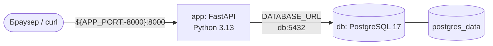

# Схема окружения проекта LifeFlow

**Команда:** LifeFlow

**Проект:** LifeFlow — система управления личными задачами, целями и финансами. Приложение позволяет пользователям планировать личные дела, отслеживать цели и вести учёт доходов и расходов.

**Дата:** 2026-11-19

## 0. Кто что делал

Распределение участников команды и их роли в проекте:

| Участник | Роль в команде | Область ответственности |
|---|---|---|
| Салахетдинов Камиль (@KamilS25) | Team Lead / Product Owner, Tech Lead / Backend Developer | Координация команды, технические решения и серверная разработка |
| Богаенко Елизавета (@ka-chow) | Frontend Developer | Разработка пользовательской части приложения |
| Сулейманова Виктория (@vst-17) | DevOps Engineer | Инфраструктура, окружение и автоматизация сборки и запуска |

В рамках практики №3 подготовлены конфигурация Docker Compose, Dockerfile, пример файла переменных окружения, подключение PostgreSQL и проверка доступности базы данных через health-check.

## 1. Схема

Схема окружения состоит из двух сервисов:

- `app` — FastAPI-приложение LifeFlow.
- `db` — база данных PostgreSQL 17.

Пользователь обращается к приложению через опубликованный порт. Приложение подключается к PostgreSQL по внутреннему адресу `db:5432` в сети Docker Compose. Данные базы сохраняются в именованном томе `postgres_data`.



## 2. Таблица сервисов

| Сервис | Образ или сборка | Порты `хост:контейнер` | Переменные окружения (только имена, без значений) | Тома | Зависит от (условие) | Healthcheck |
|---|---|---|---|---|---|---|
| app | `build: .` | `${APP_PORT:-8000}:8000` | `DATABASE_URL` | — | `db` (`service_healthy`) | — |
| db | `postgres:17` | `5432:5432` | `POSTGRES_DB`, `POSTGRES_USER`, `POSTGRES_PASSWORD` | `postgres_data:/var/lib/postgresql/data` | — | `pg_isready -U $${POSTGRES_USER} -d $${POSTGRES_DB}` |

Дополнительные сервисы не используются.

Порт приложения задаётся переменной `APP_PORT`. По умолчанию используется порт 8000. Если он занят на компьютере разработчика, его можно изменить в локальном файле `.env`.

## 3. Ответы на контрольные вопросы

### 1. Адрес базы

Приложение подключается к PostgreSQL по внутреннему адресу Docker Compose:

`postgresql://lifeflow@db:5432/lifeflow`

Полная строка подключения, включая пароль, передаётся приложению через переменную окружения `DATABASE_URL`.

Имя хоста `db` соответствует имени сервиса PostgreSQL в `compose.yaml`. Использование `localhost` внутри контейнера приложения не подходит, поскольку у контейнеров собственные сетевые пространства.

### 2. Судьба данных

Данные PostgreSQL сохраняются в именованном Docker-томе `postgres_data`.

- После `docker compose down` контейнеры останавливаются и удаляются, но именованный том сохраняется. Данные базы остаются.
- После `docker compose down -v` удаляется также именованный том. Данные базы будут потеряны.

### 3. Образ и запуск

При сборке образа приложения в него попадают:

- исходный код приложения;
- `Dockerfile`;
- `pyproject.toml`;
- `uv.lock`;
- установленные зависимости Python;
- исполняемый файл менеджера зависимостей `uv`.

При запуске контейнера передаются переменные окружения, в частности `DATABASE_URL`.

Файл `.env` используется локально Docker Compose для подстановки переменных и не включается в образ приложения. Секреты не хранятся в исходном коде и не должны попадать в Git. Для передачи конфигурации в репозитории предусмотрен `.env.example` без действующих секретов.

### 4. Миграции

На текущем этапе отдельный механизм миграций базы данных в проекте ещё не реализован.

Гипотеза: при первом запуске PostgreSQL создаёт пустую базу данных на основе переменных `POSTGRES_DB`, `POSTGRES_USER` и `POSTGRES_PASSWORD`. Создание таблиц приложения потребует отдельного механизма миграций, который будет добавлен на следующих этапах разработки.

### 5. Запуск и проверка

Для запуска всего стека используется команда:

```powershell
docker compose up --build -d
```

Для проверки состояния контейнеров:

```powershell
docker compose ps
```

Для проверки работоспособности приложения и подключения к PostgreSQL:

```powershell
Invoke-RestMethod http://localhost:8000/health
```

Ожидаемый ответ:

```json
{
  "status": "healthy",
  "database": "ok"
}
```

Эндпоинт `/health` выполняет запрос `SELECT 1` к PostgreSQL. Если база данных недоступна, приложение возвращает HTTP 503.

## 4. Проверка схемы другой командой

**Команда-рецензент:** заполняется после получения ревью.

**Рецензент:** заполняется после получения ревью (имя и логин GitHub).

Раздел предназначен для проверки схемы другой командой. Рецензент проверяет соответствие схемы конфигурации окружения, отмечает найденные проблемы и формулирует рекомендации.

### Чек-лист

| № | Критерий | Оценка | Комментарий |
|---|---|---|---|
| 1 | В стеке есть приложение и PostgreSQL | | |
| 2 | Версия образа PostgreSQL зафиксирована | | |
| 3 | Приложение обращается к БД по имени сервиса `db` | | |
| 4 | Данные БД хранятся в именованном томе | | |
| 5 | Приложение запускается после готовности БД | | |
| 6 | Опубликованные порты указаны и обоснованы | | |
| 7 | Переменные окружения перечислены без значений секретов | | |
| 8 | Описан способ создания схемы БД при первом запуске | | |
| 9 | Указаны команда запуска стека и проверка работоспособности | | |

**Главные замечания:**

1. Заполняется рецензентом.
2. Заполняется рецензентом.

**Холодное чтение:**

Заполняется рецензентом.

**Рекомендация или вопрос за пределами чек-листа:**

Заполняется рецензентом.

## 5. Что изменено по замечаниям

Раздел заполняется авторами после получения проверки другой команды.

| Замечание или рекомендация | Что изменили, почему не согласны или учтёте ли рекомендацию |
|---|---|
| Практика №3: реализована конфигурация окружения проекта с использованием Docker Compose | Добавлены два сервиса: FastAPI-приложение `app` и PostgreSQL 17 `db`. Настроены публикация портов, переменные окружения, именованный том для хранения данных и ожидание готовности БД через `service_healthy`. |
| Практика №3: добавлена проверка доступности базы данных | Эндпоинт `/health` проверяет подключение к PostgreSQL и выполняет `SELECT 1`. При успешной проверке возвращается `{"status": "healthy", "database": "ok"}`. |
| Практика №3: добавлена конфигурация переменных окружения | Создан `.env.example`. Файл `.env` исключён из Git и Docker-образа, секретные значения не включаются в документацию. |

## 6. После воркшопа

Проект использует стратегию GitHub Flow. Основная ветка — `main`. Изменения разрабатываются в отдельных рабочих ветках и передаются в `main` через Pull Request с обязательным Code Review.

В рамках практики №3 подготовлены:

- `Dockerfile` — описание сборки образа FastAPI-приложения;
- `compose.yaml` — конфигурация приложения и PostgreSQL;
- `.dockerignore` — исключение локальных и служебных файлов из контекста сборки;
- `.env.example` — пример конфигурации окружения;
- `pyproject.toml` и `uv.lock` — описание и фиксация зависимостей;
- `docs/environment-schema.md` — схема окружения проекта.

Для дальнейшей работы необходимо:

1. Получить и учесть ревью схемы от другой команды.
2. Обновить разделы 4 и 5 по результатам проверки.
3. Завершить документацию запуска проекта в `README.md`.
4. Зафиксировать решение о выборе менеджера зависимостей в ADR 002.
5. Передать изменения в `main` через Pull Request с проверкой сокомандника.

### Команды запуска

Копирование примера конфигурации:

```powershell
Copy-Item .env.example .env
```

Перед запуском необходимо указать собственный пароль PostgreSQL в `.env`.

Сборка и запуск:

```powershell
docker compose up --build -d
```

Остановка:

```powershell
docker compose down
```

Просмотр логов:

```powershell
docker compose logs -f
```

